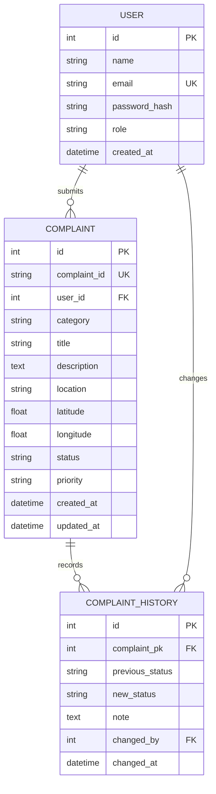

# Database design

## Entities
- **User**: account identity, password hash, role and creation timestamp.
- **Complaint**: complaint ID, citizen foreign key, category, title, description, location, optional coordinates/photo, status, priority, admin note and timestamps.
- **ComplaintHistory**: audit trail for initial submission and meaningful administrative status/note changes.

## Relationships
- One User can submit many Complaints.
- One Complaint can have many ComplaintHistory entries.
- `complaint_id` and `User.email` are unique.
- Foreign keys connect complaint to submitter and history to complaint and actor.

## ER diagram (Mermaid)

Tables are created and versioned with Django migrations (`python manage.py migrate`; the initial migration is `complaints/migrations/0001_initial.py`). After any model change run `python manage.py makemigrations` and then `migrate`. In the Django models the foreign keys are named `complaint` (history → complaint) and `changed_by`; `ComplaintHistory.changed_by` is set to NULL if that user is later removed.
